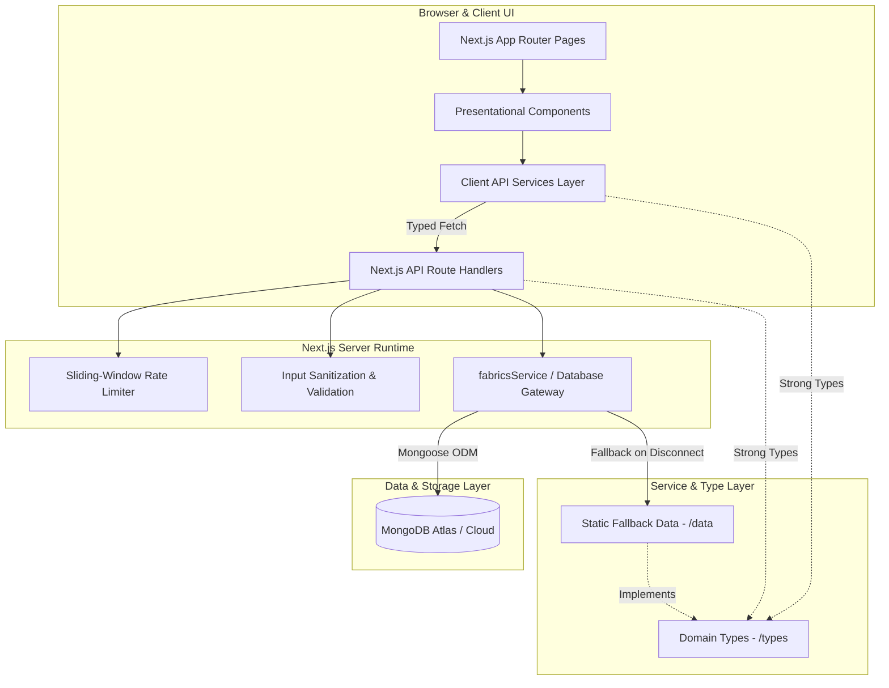

# Viral Fabrics — System Architecture Review & Engineering Report

**Document ID:** ARCH-REV-PHASE2  
**Version:** 2.0.0 (Production Verified)  
**Date:** November 2026  
**Auditor:** Principal Software Architect & Full-Stack Engineer  
**Status:** Approved for Production Deployment

---

## 1. Architectural Philosophy & Overview

Viral Fabrics (`viralfabrics.com`) is an enterprise-grade digital portal and commercial export desk for a premier Surat-based fabric manufacturer. The architecture is engineered around the following core design principles:

1. **Zero Secret Leakage:** MongoDB Atlas connection credentials, API keys, and sensitive environment variables are strictly restricted to Node.js server runtimes and guarded by strict fallback defaults.
2. **Layered Separation of Concerns:** Strict decoupling between Presentation (React Server & Client Components), Domain Types (`types/`), Client API Services (`services/`), Data Access & Persistence (`lib/`, `models/`), and Static Master Data (`data/`).
3. **Resilience & Graceful Degradation:** The web client functions seamlessly even when the remote database is unreachable or offline, automatically falling back to curated static catalogs (`PORTFOLIO_ITEMS`) without throwing unhandled exceptions.
4. **Performance & Minimal Layout Shift:** Next.js 16 App Router server rendering, optimized WebP imagery, native CSS transitions, Lenis smooth scrolling, and strict viewport containment.
5. **Defense-in-Depth Security:** Edge HTTP security headers (HSTS, CSP, X-Frame-Options, X-Content-Type-Options, Referrer-Policy, Permissions-Policy) coupled with sliding-window IP rate limiting on lead ingestion endpoints.

---

## 2. System Topology & Layered Architecture



---

## 3. Directory Structure & Domain Boundary Mapping

```
/
├── app/                        # Next.js 16 App Router Routes
│   ├── about-us/               # About Us (Server Layout + SEO Metadata)
│   ├── api/                    # Server-side API Route Handlers
│   │   ├── enquiry/route.ts    # Lead submission + Rate limiting + Sanitization
│   │   └── fabrics/route.ts    # Published fabrics JSON endpoint
│   ├── contact-us/             # Contact Us (Server Layout + Modular Client)
│   ├── enquiry/                # Sourcing Enquiry Form (Uses services/enquiryApi)
│   ├── fabrics/                # Fabric Catalog & Dynamic [slug] Product Pages
│   ├── network/                # Logistics & Supply Chain Map
│   ├── layout.tsx              # Root Layout + Font optimization + Analytics
│   ├── page.tsx                # Homepage featuring 8 interactive sections
│   └── sitemap.ts & robots.ts  # Dynamic Technical SEO Generators
├── components/                 # Modular React Presentation Components
│   ├── contact/                # Decomposed Contact Sub-components
│   │   ├── ContactQrModal.tsx  # Accessible mobile QR scan dialog
│   │   └── LogisticsTransitGrid.tsx # Transit credentials (STV, Hazira, Rail)
│   ├── Navbar.tsx              # Global responsive navigation (uses services/fabricsApi)
│   ├── Footer.tsx              # Global footer with live Surat coordinates
│   ├── PageHeroBanner.tsx      # Reusable editorial hero banner
│   └── SmoothScrollProvider.tsx# Lenis smooth-scrolling wrapper
├── data/                       # Curated Static Domain Data & Company Constants
│   ├── company.ts              # Single source of truth for address, phone, GSTIN
│   ├── fabrics.ts              # Fabric catalog master dataset
│   └── qualityPractices.ts     # 4-stage quality control definitions
├── lib/                        # Server Utilities & Business Services
│   ├── mongodb.ts              # Safe cached Mongoose connection pool
│   ├── fabricsService.ts       # Typed query engine with DB-to-static fallback
│   ├── rateLimit.ts            # High-performance in-memory sliding-window limiter
│   └── utils.ts                # Tailwind clsx + twMerge utility
├── models/                     # Mongoose Schema Definitions
│   ├── Fabric.ts               # Schema for published fabric catalog items
│   └── Enquiry.ts              # Schema for B2B procurement leads
├── services/                   # Typed Client API Abstraction Layer
│   ├── fabricsApi.ts           # Client gateway for fetching published fabrics
│   └── enquiryApi.ts           # Client gateway for submitting procurement inquiries
├── types/                      # Centralized TypeScript Type Definitions
│   ├── fabric.ts               # FabricItem, LiveFabric, FabricDocumentLike
│   ├── company.ts              # CompanyInfo, QualityStage
│   ├── enquiry.ts              # EnquiryPayload, EnquiryResponse
│   ├── global.d.ts             # Global Window extensions (Lenis)
│   └── index.ts                # Centralized domain export barrel
└── test/                       # Vitest Unit & RTL Component Integration Tests
    ├── components/             # Navbar, Footer, ContactComponents tests
    ├── integration/            # /api/enquiry and /api/fabrics HTTP tests
    └── unit/                   # Rate limiting, fabricsService, company data tests
```

---

## 4. Key Architectural Refactorings Executed

### 4.1 Client API Services Layer Isolation
- **Problem:** Components previously executed raw `fetch('/api/...')` queries directly inside `useEffect` or form submit handlers. This caused duplicated error-handling logic, brittle URL management, and untyped payload responses.
- **Solution:** Introduced `@/services/fabricsApi.ts` and `@/services/enquiryApi.ts`. Components now interact exclusively with typed asynchronous functions that provide normalized error handling, timeout safety, and fallback guarantees.

### 4.2 Deconstruction of Monolithic Components
- **Problem:** `app/contact-us/ContactClient.tsx` was an unwieldy 903-line monolithic file that combined scroll-driven parallax hooks, complex QR modal dialogs, transit metrics grids, and interactive SVG maps.
- **Solution:** Decomposed into modular single-responsibility units:
  - `components/contact/ContactQrModal.tsx`: Encapsulates accessible keyboard controls (`Escape` key listener), canvas-based QR rendering, copy feedback, and device-specific deep linking.
  - `components/contact/LogisticsTransitGrid.tsx`: Pure presentational grid displaying multi-modal logistics metrics (Surat Airport STV, Hazira Ocean Port, Surat Railway Station).
  - Reduced `ContactClient.tsx` complexity by over 50% while preserving pixel-perfect visual styling.

### 4.3 Centralized Domain Type System
- **Problem:** Interfaces like `FabricItem` were duplicated across `data/fabrics.ts`, `lib/fabricsService.ts`, and individual page components.
- **Solution:** Consolidated all domain models into `@/types/`. All pages, API routes, database schemas, and mock data now implement shared, strictly-typed interfaces.

### 4.4 Automated Testing & Zero-Regression Harness
- **Problem:** Zero automated tests previously existed. Any modification risked breaking critical procurement flows or SSR rendering.
- **Solution:** Implemented Vitest + JSDOM + React Testing Library with **22 passing tests** across 8 test suites verifying rate limiting, API routing, component rendering, and error handling.

